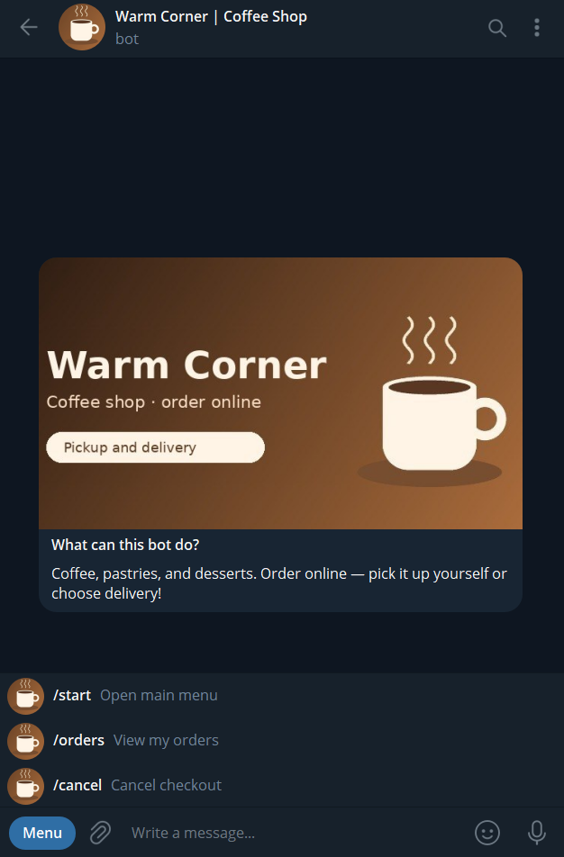
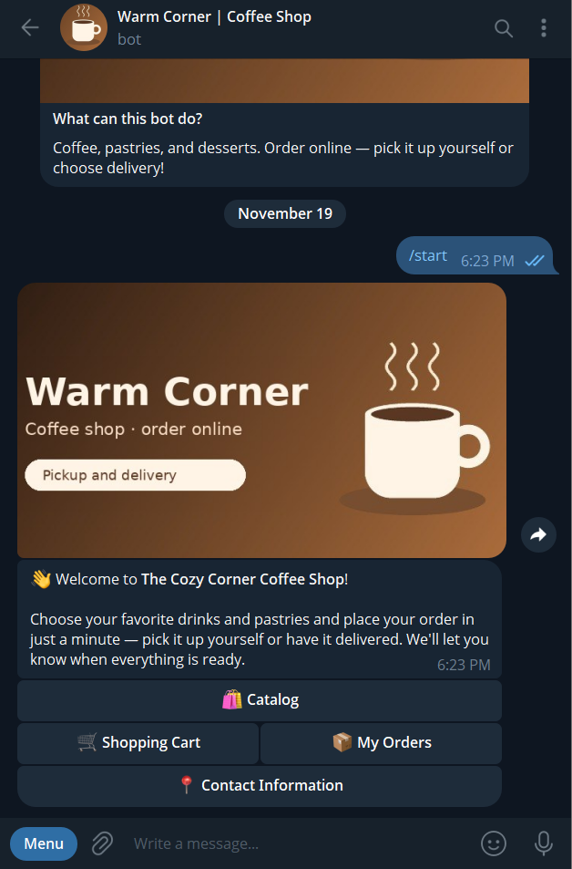
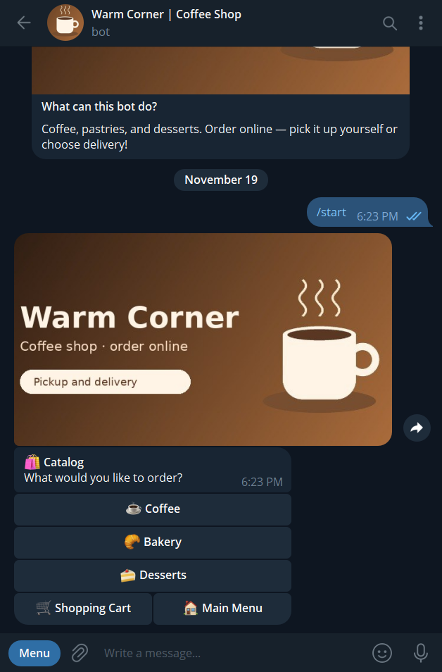
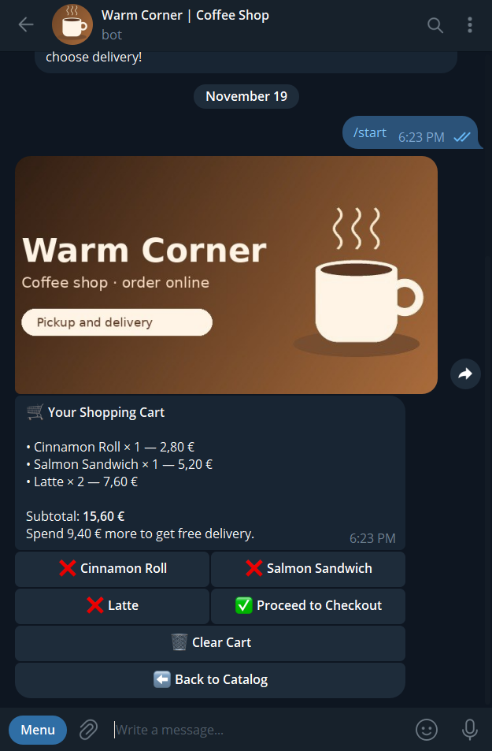
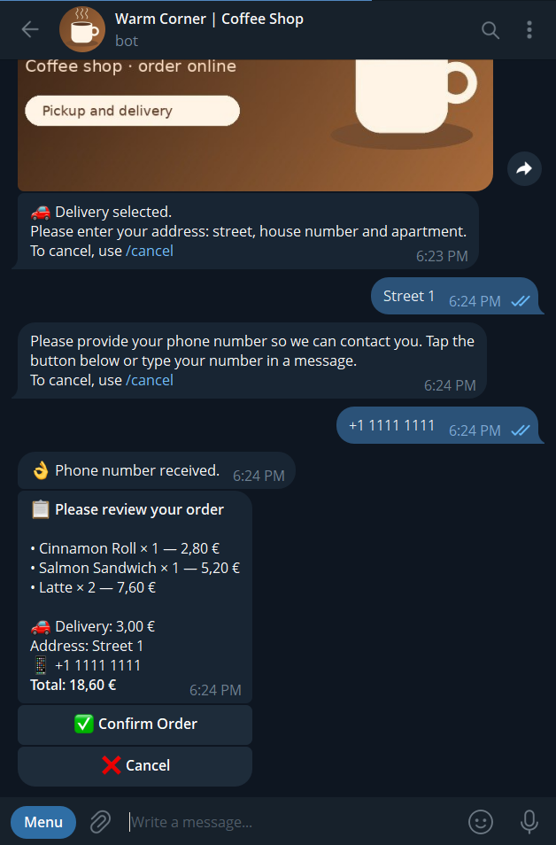
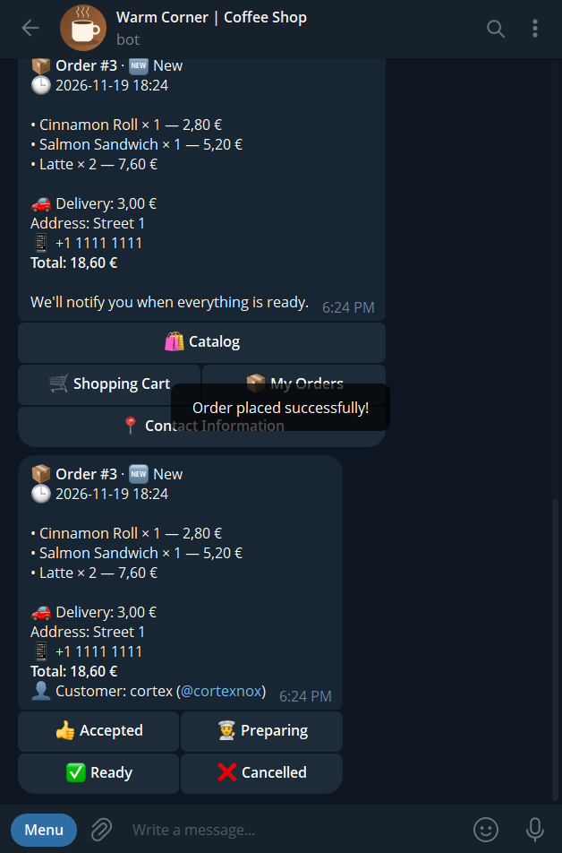

# Coffee Shop Telegram Bot

A Telegram bot for a coffee shop featuring a product catalog, shopping cart, and order checkout. Customers can browse coffee, pastries, and desserts, choose a pickup or delivery option, and provide their contact phone number.

The shop owner receives notifications about new orders, updates order statuses directly in Telegram, and views daily sales statistics.

## Features

- Product catalog with categories: coffee, bakery, and desserts.
- Product cards with descriptions, prices, and quantity selection.
- Shopping cart: add and remove products, clear the cart.
- Order checkout with pickup or delivery options.
- Address and phone number collection.
- Automatic delivery fee calculation.
- Free delivery for orders above a specified amount.
- "My Orders" section with recent orders and their statuses.
- Customer notifications when order statuses change.
- Administrative buttons for order management.
- `/admin` — daily order count, total revenue, and the 10 most recent orders.

## Installation and Setup

1. Create a bot using [@BotFather](https://t.me/BotFather) and obtain your bot token.

2. Create a `.env` file:

```env
BOT_TOKEN=your_bot_token
ADMIN_ID=your_telegram_id
DB_PATH=shop.db
```

3. Create a virtual environment:

```bash
python -m venv .venv
```

4. Activate the virtual environment:

```bash
# Windows
.venv\Scripts\activate

# Linux / macOS
source .venv/bin/activate
```

5. Install the dependencies:

```bash
pip install -r requirements.txt
```

6. Start the bot:

```bash
python bot.py
```

The SQLite database and all required tables are created automatically on the first launch.

## Customization

You can customize the bot by editing the configuration section at the beginning of `bot.py`.

Available settings include:

- Shop name.
- Currency.
- Delivery fee.
- Minimum order amount for free delivery.
- Product categories.
- Product names and descriptions.
- Product prices.

The welcome message and contact information can also be customized directly in the code.

## Bot Commands

- `/start` — open the main menu.
- `/orders` — view the customer's recent orders.
- `/cancel` — cancel the current checkout process.
- `/admin` — view daily statistics and recent orders (owner only).

## Tech Stack

- Python
- aiogram 3
- SQLite
- aiosqlite
- asyncio
- FSM (Finite State Machine)
- python-dotenv

## Screenshots

### 1. Main Menu



### 2. Product Catalog



### 3. Product Details



### 4. Shopping Cart



### 5. Checkout



### 6. Order Confirmation



## Project Structure

```text
telegram-coffee-shop-bot/
├── bot.py
├── requirements.txt
├── .env.example
├── .gitignore
├── README.md
├── welcome.png
└── screenshots/
    ├── 01_welcome.png
    ├── 02_catalog.png
    ├── 03_product.png
    ├── 04_cart.png
    ├── 05_checkout.png
    └── 06_confirmation.png
```

---

**Built with Python and aiogram 3.**